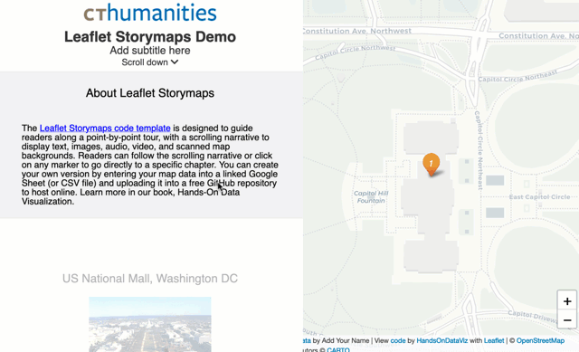
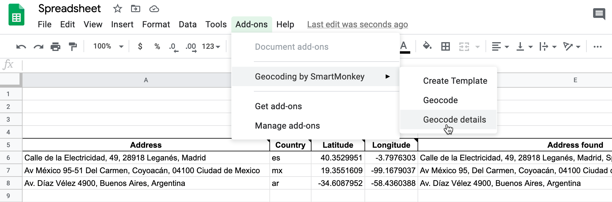

# Leaflet Storymaps with Google Sheets: Extended Documentation
*Margaret K. Smith, Southern Illinois University Edwardsville*

This repo is a fork of Jack Dougherty and Ilya Ilyankou's Leaflet Storymaps with Google Sheets, from their book *Hands-On Data Visualization*. Their full documentation is below. This fork contains extended documentation and customizations developed for the IRIS Center for Digital Humanities at Southern Illinois University Edwardsville.

## Contents
* [Customizing Markers](#changing-the-defaultinactive-marker)
* [Customizing Fonts](#customizing-fonts)

## Customizing Markers
The data entry spreadsheet offers some options for customizing markers: color, display, and content (e.g. numbers or letters). However, the underlying code allows for significantly more customization. Note that the current version of the storymap uses an old version of the Leaflet ExtraMarkers extension, and updating the markers requires utilizing the [previous version of their documentation](https://github.com/coryasilva/Leaflet.ExtraMarkers/tree/c4f5f1e4184194b584ef112a609af7a1f91db172).

### Changing the Default/Inactive Marker
The default marker is constructed in `scripts > storymap.js`:
```
markers.push(
          L.marker([lat, lon], {
            icon: L.ExtraMarkers.icon({
              icon: 'fa-number',
              number: c['Marker'] === 'Numbered'
                ? chapterCount
                : (c['Marker'] === 'Plain'
                  ? ''
                  : c['Marker']), 
              markerColor: c['Marker Color'] || 'blue'
            }),
            opacity: c['Marker'] === 'Hidden' ? 0 : 0.9,
            interactive: c['Marker'] === 'Hidden' ? false : true,
          }
        ));
```
You can edit or add `icon` properties. Be sure to only adjust the static properties! Anything with a value of `c['Marker']` is set by data in the spreadsheet, and changing it here will override the spreadsheet. If you add properties, make sure you separate them with a comma and enclose the value in quotation marks: `iconColor: 'white',`
* iconColor: This will set the color of the text inside the marker. You can use named or hex colors.
* shape: This changes the shape of the whole marker. You can choose from circle, square, star, or penta.

Commit your changes before heading to the next step, which occurs in a different file.

### Changing the Active Marker
Changes to the default marker **do not** update the active marker, which by default is an orange circle. The process for changing this is a little different: The default marker is a segment of an [image](https://github.com/coryasilva/Leaflet.ExtraMarkers/blob/c4f5f1e4184194b584ef112a609af7a1f91db172/src/assets/img/markers_default.png), which contains 60 combinations of shape and color.


Changes to the active marker happen in `css > style.css`:
```
.marker-active {
  background-position: -72px 0 !important;
}
```
The `background-position` property contains the coordinates in the picture of the marker you'd like to use. Once you've selected your marker, consult the [CSS reference](https://github.com/coryasilva/Leaflet.ExtraMarkers/blob/c4f5f1e4184194b584ef112a609af7a1f91db172/src/assets/img/markers_default.png) to find the appropriate coordinates.

## Customizing Fonts

Swapping out the fonts requires making changes to `index.html` and to `css/style.css`. 

### 1. Choose your fonts.

Go to Google Fonts and select the fonts you'd like to add to your project. You can add multiple fonts at a time. When you find a font you'd like to use, click the green "Get Font" button in the top right of the page. You can keep searching, and it will store all your choices for when you're ready to export them. 

When you're done choosing fonts, click on the shopping bag in the top right corner to view all your selections. Click the blue "Get embed code" button on the right of the page. 

### 2. Edit index.html

In a separate tab, open your `index.html` file and click the pencil icon to edit it. From Google Fonts, copy the embed code designated for the <head> of your HTML document. In your `index.html` file, add a new line after `<title>Leaflet Storymaps with Google Sheets Template</title>` and paste it there. Click the green "Commit changes" button to save your changes. (Remember to click it again in the dialog box that pops up.)

### 3. Edit css/style.css

Open up `style.css` in the `css` directory. You'll need to update each element individually.
* Body text: By default, this is set to Helvetica. If you're changing the body font (which will update the chapter text and captions), find the `body` `font-family` declaration:
```
body {
  padding: 0px;
  margin: 0px;
  font-family: "Helvetica", sans-serif;
  overflow: hidden;
}
```
Copy the `font-family` declaration for the appropriate font from your Google Fonts embed page. This will be in the individual font's CSS class block (for example, `font-family: "Aladin", system-ui;`).
* Title: To style your story title, search for `#title` and follow the same steps, substituting the appropriate font.
* Chapter titles: These are styled under `.chapter-header`.
* You can also style all headers throughout the storymap by updating `h1`, `h2`, etc.
* As you change fonts, you may find that you also want to change font sizes. In the storymap, these are styled using *em* units, which are relative units, where the number multiplies the original font size. (1.5em is one and a half times the size of 1em; 2em is double.) This helps to keep everything proportionate.
* Other changes, like color, can be made in the spreadsheet.

Commit your changes. If you are hosting via GitHub Pages, it will take a few minutes for your site to update. (NB: The more commits you make in a session, the longer your live site will take to update each time.)

# [Leaflet Storymaps with Google Sheets: Original Documentation](https://www.github.com/handsondataviz/leaflet-storymaps-with-google-sheets)
*Jack Dougherty and Ilya Ilyankou*

Customize your Leaflet story map with linked Google Sheets template and scrolling narrative.
Supports images, audio and video embeddings, and Leaflet TileLayer/geojson overlays.

<p align="center">
  
</p>

## Live links (replace with your own)
- Leaflet Map https://handsondataviz.github.io/leaflet-storymaps-with-google-sheets/
- Google Sheets template https://docs.google.com/spreadsheets/d/1DnJR3HyKkF1b5vWY2AOfftOqRrFWrpSpAh1W9K6F0sQ/edit?gid=1033046795#gid=1033046795

## Create Your Own
- See step-by-step tutorial in *Hands-On Data Visualization* https://HandsOnDataViz.org/leaflet-storymaps-with-google-sheets.html

#### Geocode your address data with Google Sheets add-on
To geocode (find latitude and longitude coordinates), we recommend installing the free [Geocoding by SmartMonkey add-on for Google Sheets](https://gsuite.google.com/marketplace/app/geocoding_by_smartmonkey/1033231575312). Insert your addresses in place of the samples in the Geocoding Details tab, then use Add-Ons > Geocoding > Geocode Details menu. Learn more in *Hands-On Data Visualization* https://handsondataviz.org/geocode.html



#### To finalize your map, you need to either:
- Download each Google Sheets tab as a CSV file and upload into a `csv` subfolder in your GitHub repo
  - OR
- Get your own Google Sheets API Key to insert into `google-doc-url.js`

See more in the tutorial https://handsondataviz.org/leaflet-storymaps-with-google-sheets.html

## Update your code to address CARTO API KEY issues after September 2026
If you used our code to create a map prior to September 2026, you may need to update your version to address a CARTO API KEY MISSING issue that prevents basemap tiles from displaying. See details in the [Get Your CARTO Basemaps API Key](https://handsondataviz.org/carto-basemaps-api-key.html) section of our book.

## Update your code for any pre-October 2020 storymaps before January 2021
If you used our code to create a storymap prior to October 2020, you will need to update your version before January 26, 2021 for it to continue to work. Google announced that it will [migrate from Google Sheets API v3 to v4 in Jan 2021](https://developers.google.com/sheets/api/v3), and we released our update of Leaflet storymaps code v1.2 on September 29th to address Google's changes.

Three options to update your code:

Option A: If you understand (or are willing to learn about) [GitHub Desktop](https://handsondataviz.org/github-desktop-atom.html), use it to move copies of the newer code (index.html, scripts folder, markers folder, style.css, etc.) into your repo via your local computer. In the `google-doc-url.js` file, copy and paste the Google Sheets API key that appears in the lower half of our code, but keep your own Google Sheets ID that appears in the upper-half of your code.

OR

Option B: If you originally "forked" a copy of our code, create a GitHub "pull request" to update your repo with our code revisions, including the Google Sheets API key. We recommend this option only if you understand (or are willing to learn about) GitHub pull requests, and can deal with resolving conflicts between your code and our updated code.
Warning: Since this operation might overwrite some of your code, go to *Code > Download ZIP* to make a backup to your local computer.
1. Log into the web interface of your GitHub storymap repository.
2. Click *Pull requests* and click the green button for a *New pull request*.
3. On the *Comparing Changes* page, use the menus to pull code *into* your repo *from* the original repo, named HandsOnDataViz/leaflet-storymaps-with-google-sheets. GitHub may warn that you cannot automatically merge the files, but proceed anyways.
4. You may need to click the *Resolve conflicts* button on the next screen, which means you need to sort out which portions of your code to keep and which portions of our code to accept. Generally speaking, you should accept our updates for index.html, style.css, and most scripts.js, while keeping your own content for README.md, media, and geojson folder content. In the google-doc-url.js file, you should keep your own Google Sheet ID, but temporarily add our Google Sheets API key until you create your own. In GitHub, you can resolve code conflicts by deleting/keeping lines in specific files.

OR

Option C: Start over with a brand-new repo, and migrate your existing map content. Make a copy of our newer code by clicking the green 'Use template' button. Migrate any media folder or geodata folder content from your old repo to your new repo, by downloading to your local computer and uploading to GitHub. Reconnect your Google Sheet ID to the `google-doc-url.js` file in your new repo.

Email us at [HandsOnDataViz@gmail.com](handsondataviz@gmail.com) if you need assistance with updating your code.

## Credits (and licenses)
Developed by [Ilya Ilyankou](https://github.com/ilyankou) and [Jack Dougherty](https://github.com/jackdougherty) with support from Connecticut Humanities and Trinity College, CT. Inspired by Code for Atlanta mapsfor.us (2016) https://github.com/codeforatlanta/mapsforus (BSD-3-Clause). Adapted from MUX Lab, Map Effects 100: https://github.com/muxlab/map-effects-100, see http://muxlab.github.io/map-effects-100/Leaflet/11_scroll-driven-map-navigation.html.

We use [Google Sheets API version 4](https://developers.google.com/sheets/api), with these open-source components:

- Leaflet v1.7.1 https://leafletjs.com (BSD-2-Clause)
- jQuery v3.5.1 https://code.jquery.com (MIT)
- PapaParse v5.3.0 to parse CSV with JavaScript (MIT)
- Font Awesome v5.8.1 https://cdn.fontawesome.com (MIT, SIL OFL 1.1)
- leaflet-providers (v4.0.0) https://github.com/leaflet-extras/leaflet-providers (BSD-2-Clause)
- Leaflet.awesome-markers (v2.0.4), manually updated to svg to allow hex and material icons https://github.com/sigma-geosistemas/Leaflet.awesome-markers (MIT)
- Leaflet.ExtraMarkers (v1.0.5) https://github.com/coryasilva/Leaflet.ExtraMarkers (MIT)
- jQuery-CSV (v1.0.11) https://github.com/evanplaice/jquery-csv (MIT)
- Single Element CSS Spinner (31 May 2016) https://github.com/lukehaas/css-loaders (MIT)
- Lightbox by Lokesh Dhakar (v.2.11.3) https://github.com/lokesh/lightbox2 (MIT)
